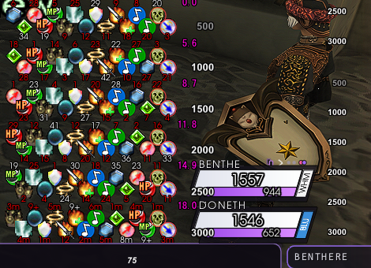

# PartyBuffs for Ashita v4 / VanaCore

Shows your party's buffs next to the game's own party list, with timer rings, time-left text and
range text. Made for CatsEyeXI.



## Install

Put this folder in `addons\partybuffs`, then in game:

```
/addon load partybuffs
```

## Use

- `/partybuffs` (or `/pb`) opens the settings window.
- Hold **Shift** and drag the icons to move them.
- **Test Mode** (top of the settings sidebar) fills the party with sample buffs so you can set things up alone.

## Features

- **Icon themes:** XIView and XIView-Yuna, with icon size and spacing.
- **Grow up or down:** the top of the Icons page sets which way the list adds members.
- **Every buff shown:** each buff gets its own icon and timer, so two Minuets show twice and Geo Haste shows beside Haste. "Merge same-name buffs" on the Icons page puts them back to one icon.
- **Haste, Phalanx, Refresh first:** those three sit together next to the party list (behind any debuffs), with Phalanx on the top row of a zigzag.
- **Timer rings:** a ring around each icon that runs down as the buff wears off. You can set the colors, the
  style of the moving end (sparkle, dot or none), the dot size, and blinking when low. You can also show
  rings only when a buff is low.
- **Timer text:** time left under each icon. You can cap it ("5+"), hide it above a set time, or show it only for known durations.
- **Exact timers from your other clients:** your clients on the same PC share their exact times and real buff lists, so those characters aren't estimated. It's on by default, and "Share with my other clients" on the Timer Rings page turns it off. Other players stay estimated.
- **Better estimates:** buff lengths are measured per caster, job and spell when a cast lands on one of your characters, and all your characters share them. Composure is kept apart, and a buff leaves its icon as soon as its wear-off message arrives.
- **Draw In Front:** separate switches on the Display menu put Icons, TP, Distance and HP over the party frames.
- **Range text:** each member's distance, with its own font and position.
- **Saved Themes:** save the whole look under a name and load it from a dropdown. Every character can use it. You can also copy your current setup straight to your other open clients (needs VanaCore).
- **TP and target numbers:** each party's TP and your target's HP%, from the tparty addon. Party 1 moves with the buffs; the alliance parties and the target move on their own. `/tparty` opens these pages.
- **Filters, priority and profiles:** choose which buffs show and in what order.

The settings window uses the VanaCore menu library (`vcmenu.lua`). The timer text uses YunaUI's font under
VanaCore.

## Credits

Based on Thorny's PartyBuffs ([ThornyFFXI/MiscAshita4](https://github.com/ThornyFFXI/MiscAshita4)), with the TP numbers from atom0s's tparty. The icon themes
come from HXUI, and the font is TeX Gyre Adventor, which YunaUI also uses. See [NOTICE.md](NOTICE.md).

## License

GPL-3.0. See [LICENSE](LICENSE).
